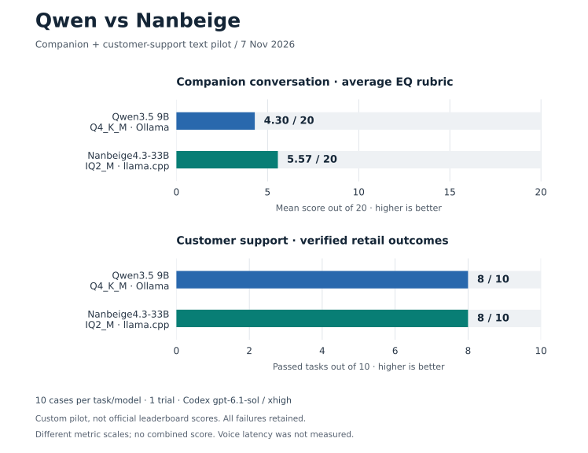
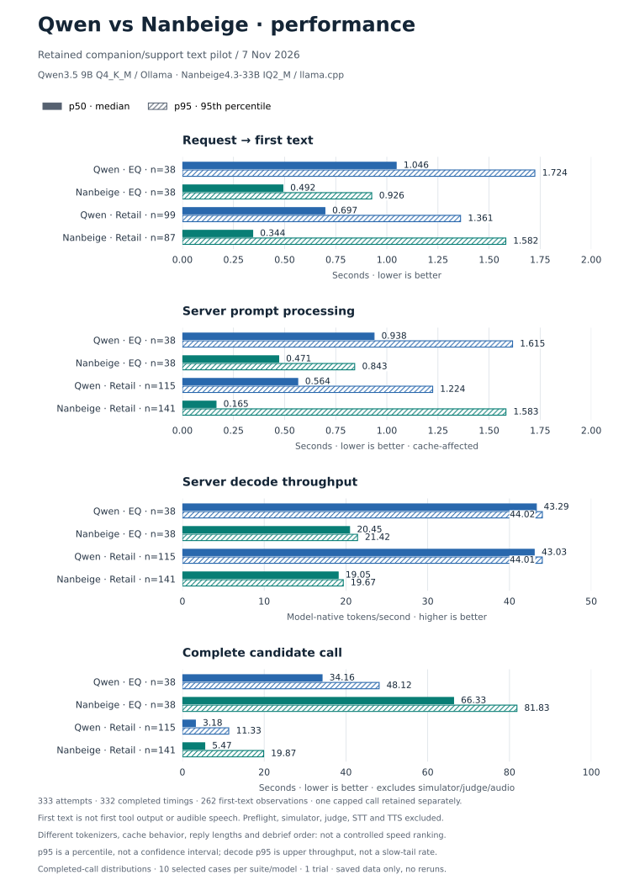

# Matched Qwen–Nanbeige companion/support pilot — final comparison

Completed 2026-11-07. These are **custom ten-case text pilots**, not official leaderboard scores or an audio evaluation.

## Headline results

| Deployable configuration | EQ rubric mean (0–20) | EQ scenarios scored | Retail outcomes |
| --- | ---: | ---: | ---: |
| Qwen3.5 9B Q4_K_M / Ollama | 4.30 | 10/10 | 8/10 |
| Nanbeige4.3-33B IQ2_M / llama.cpp | 5.57 | 10/10 | 8/10 |

The chart uses separate zero-based scales: EQ is a mean quality score, retail
is a passed-task count. They are not averaged into one overall score.
[PNG](assets/qwen-nanbeige-comparison.png) ·
[Plotted data and source hashes](assets/qwen-nanbeige-comparison.json) ·
[Reproducible plot script](plot-comparison.py).
Regenerate with `python3 plot-comparison.py` from this directory (Matplotlib
required); it checks the ten per-scenario CSV scores against the saved summaries
and makes no model calls.

Nanbeige is **+1.27 points** on this selected EQ rubric, with no retail pass-count improvement. This single judge, one-trial, ten-case pilot does not establish statistical superiority, normal spoken naturalness, or a reason by itself to replace the production model.

Both EQ candidates completed all 28 dialogue calls and ten debrief calls (38/38 each). All ten complete response sets per candidate were scored, using the mean of six higher-is-better criteria within each scenario, then the mean across scenarios. The other twelve style/safety fields are retained but are not added to that score. There were **zero final EQ collection/grading errors or unscored scenarios**.

## Per-scenario EQ scores

| ID | Qwen | Nanbeige | Difference |
| --- | ---: | ---: | ---: |
| 1 | 3.500 | 4.833 | +1.333 |
| 2 | 2.833 | 4.333 | +1.500 |
| 3 | 2.833 | 3.667 | +0.833 |
| 6 | 4.333 | 4.000 | -0.333 |
| 9 | 5.667 | 6.833 | +1.167 |
| 13 | 3.333 | 6.667 | +3.333 |
| 131 | 6.167 | 7.667 | +1.500 |
| 133 | 4.500 | 7.667 | +3.167 |
| 137 | 4.500 | 3.833 | -0.667 |
| 302 | 5.333 | 6.167 | +0.833 |

## Retail outcomes and errors

| Task ID | Qwen reward | Nanbeige reward |
| --- | ---: | ---: |
| 6 | 1 | 1 |
| 8 | 1 | 1 |
| 11 | 1 | 1 |
| 13 | 1 | 1 |
| 14 | 0 | 1 |
| 16 | 1 | 1 |
| 17 | 1 | 0 |
| 18 | 1 | 0 |
| 19 | 0 | 1 |
| 21 | 1 | 1 |

- Qwen task **14** failed its final database comparison: clarification loops ended in transfer rather than the expected returns. Task **19** reached the unchanged 1,024-token reply cap. That incomplete trajectory remains reward zero, not retried or removed from the ten-task denominator; only previously unattempted task 21 ran afterward.
- Nanbeige task **17** failed its database comparison: repeated promises to fetch/update the order did not perform the address update, ending in transfer. Task **18** also failed its database comparison. Its actual exchange selected item `8069050545` (the same chair), while the frozen expected exchange selects gray variant `1071497737`. The tool listing marked the same chair available and the independent customer chose it, so this failure is sensitive to the customer/reference branch, not evidence of a provider error. The upstream zero is retained without regrading or changing fixtures.
- Nanbeige had **zero candidate cap/context/format failures** and no terminal controller error. Its ten retail trajectories completed; Qwen has nine full trajectories plus the explicit task-19 budget failure.
- Retail candidate calls: Qwen **116 attempts / 115 completed timing records** (the capped call has no completed timing row); Nanbeige **141 / 141**. Timing-only summaries must not drop the capped attempt from outcome denominators.
- Of the 19 completed retail trajectories, 14 have no NL assertions. Separate semantic checks passed for Qwen tasks 16/21 and Nanbeige tasks 16/19/21 (six assertions total). Empty assertion lists vacuously pass; action-check diagnostics are preserved and are not an exhaustive policy-compliance test. A reward of one does not certify every utterance, policy nuance, or spoken style.
- Retail Codex customer/result calls audited: **64 Qwen + 91 Nanbeige**. All used fresh `gpt-6.1-sol` / `xhigh` structured sessions through the existing CLI ChatGPT login. Alongside the 20 EQ judgments, all **175** saved Codex responses passed their schema and raw-event no-tool audit. No API-key fallback or extra inference was used by the completion audit.

## Matching and deliberate differences

- Same preselected EQ IDs and prompts/master/debrief, retail IDs and byte-identical task inputs, policy, English language/persona bindings, upstream engine, independent evaluator route, and aggregation. All ten pinned source hashes and both upstream commits were rechecked. Retail configs are equal except candidate name.
- Both candidates: non-thinking mode, 32K benchmark context; EQ dialogue temperature 0.7 / min_p 0.1, debrief temperature 0.5 / effective min_p 0; retail temperature 0.5 / min_p 0.1. Shared top_p 0.95, top_k 20, presence penalty 0, repetition penalty 1, seed 42. EQ cap 12,000 and deadline 600s; retail reply cap 1,024, call deadline 180s, task deadline 1,800s and maximum 200 steps. Task seed 300.
- Qwen uses installed Ollama Q4_K_M; Nanbeige uses the recorded IQ2_M weights and CUDA llama.cpp b12064 with Q4_0 K/V cache, all 53/53 layers on GPU. Native tokenizers/chat templates and cache precision differ. This compares actual deployable packages, not architecture or full-precision quality in isolation.
- The initial Nanbeige adapter blocked ten debrief calls **before inference** because it accepted only dialogue sampling. The ten previously uncalled debriefs were recovered after dialogue collection. Archived dialogue responses/history were independently compared and remain unchanged; zero previous model calls were retried. This changed debrief ordering/cache behavior, so cache/prefill timing is not matched. Two startup-only compatibility/logging errors were also preserved locally before any scored inference, not counted as model-quality outcomes.

## Retained performance

Solid bars show p50; hatched bars show p95, not confidence intervals. These are
saved text-call distributions, not a controlled speed ranking or audible latency.
See [performance definitions, coverage and prompt/cache-counter chart](PERFORMANCE.md)
and [exact plotted values with source hashes](assets/qwen-nanbeige-performance.json).

## Voice restoration

The independent check at **2026-11-07 21:58:33 UTC**, after controller/server exit, confirmed the original voice service active/running/thawed, `/api/health` ready=true and busy=false, original `local-voice-qwen:latest` loaded at **4096 context**, Nanbeige port 8083 closed, and no Nanbeige controller/server process. This confirms service/model readiness, **not a new end-to-end audio call**. No STT/TTS, first useful spoken response, interruption, browser playback or acoustic latency was measured. No DNS/access configuration was changed.

## Evidence and replay

- [Retained performance: first text, prefill counters, decode, wall time and per-call evidence](PERFORMANCE.md)
- [Machine-readable matching, coverage and component-reward audit](results/nanbeige-iq2m/matched-audit.json)
- [Independent post-run service verification](results/nanbeige-iq2m/post-run-verification.json)
- [Nanbeige run protocol, recovery and replay](results/nanbeige-iq2m/RESULTS.md)
- [Nanbeige EQ scores and all six/eighteen rubric fields](results/nanbeige-iq2m/eq10/codex-judge/scores.csv)
- [Nanbeige candidate EQ call audit](results/nanbeige-iq2m/eq10/candidate-call-audit.csv) and [retail call audit](results/nanbeige-iq2m/retail10/candidate-call-audit.csv)
- [Nanbeige retail trajectories and task inputs](results/nanbeige-iq2m/retail10/tasks/) and [Codex provenance](results/nanbeige-iq2m/retail10/codex-provenance.json)
- [Qwen EQ assessments](results/qwen-eq10/codex-judge/RESULTS.md), [retail results](results/qwen-retail10/RESULTS.md) and [Codex provenance](results/qwen-retail10/codex-provenance.json)
- [Setup, exact runners, pinned fixtures and limits](README.md) and [interpretation audit](RUN-AUDIT.md)

Explicit EQ prompts, schemas, structured judgments and source/prompt/schema hashes are published. Schema hashes use sorted-key JSON serialization, not pretty-printed file bytes. Benchmark trajectories contain synthetic fixture identities. Raw token streams, CLI event logs/stderr, authentication and machine-specific startup paths stay local. No weights, private credentials or model downloads are included.
