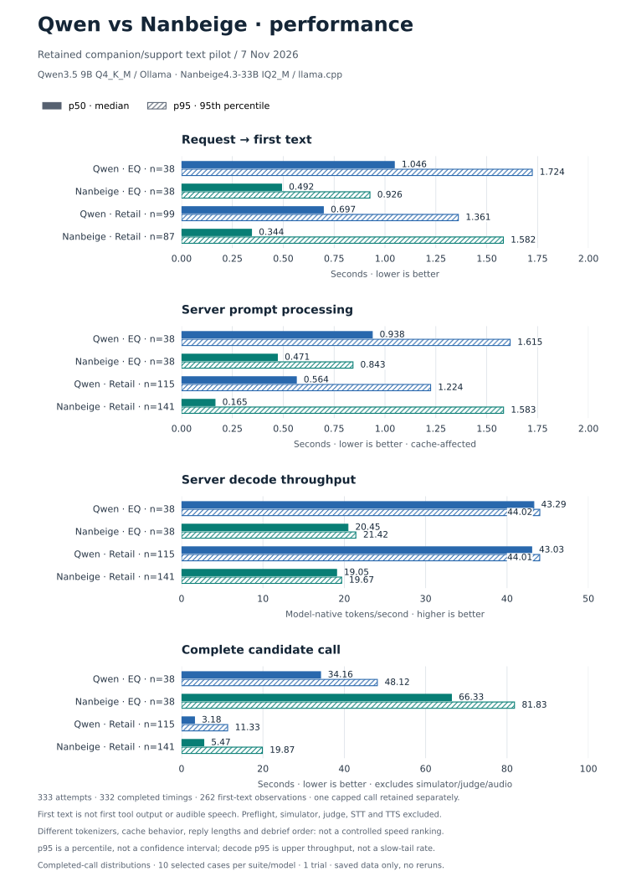
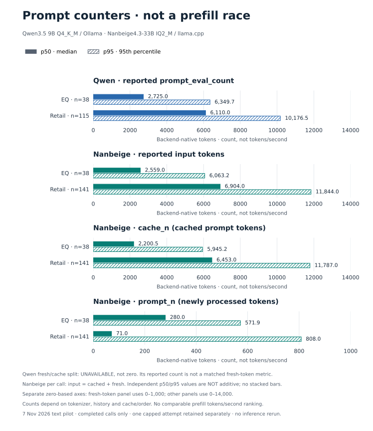

# Retained Qwen–Nanbeige performance evidence

Original inference: **2026-11-07**. Counter export: **2026-11-08**. This report
uses saved candidate streams/timing files only: **no inference was rerun**.
Quality scores and all ten-task outcome denominators remain unchanged in
[the matched comparison](COMPARISON.md).

## Visual comparison



Solid bars are **p50 (median)**; hatched bars are **p95 (95th percentile)**,
not error bars or confidence intervals. Every axis starts at zero. Decode p95
is an upper-throughput percentile, not a slow-tail rate. The first-text panel
excludes tool-only nulls; other panels use all completed timing records.



Prompt counts use each backend's native counter semantics. **Do not stack
independent percentiles**: the p50/p95 of total input is not generally the sum
of cached and fresh p50/p95 values. The fresh-token panel uses a smaller,
explicitly labeled zero-based axis. Qwen's unavailable cache split is not
plotted as zero, and these counts are not a prefill-throughput ranking.

[Timing PNG](assets/qwen-nanbeige-performance.png) ·
[Prompt-counter PNG](assets/qwen-nanbeige-prompt-counters.png) ·
[Exact plotted values and source hashes](assets/qwen-nanbeige-performance.json) ·
[Reproducible chart script](plot-performance.py).
Regenerate with `python3 plot-performance.py` (Matplotlib required). The script
recomputes all distributions from the committed per-call CSV and checks them
against the summary before drawing. It makes no model calls and does not
modify source evidence.

## Completed-call distributions

Each cell is **p50 / p95**, not an average of scenario summaries. First text,
prompt processing and full-call wall time are in **seconds**; decode rate is
**model-native output tokens/second**. Higher decode rate is better; lower
latency is better. Metrics pool calls within each suite, so cases with more
turns contribute more observations.

| Candidate / suite | Request → first text (s) | Server prompt processing (s) | Server decode (tokens/s) | Full-call wall time (s) |
| --- | ---: | ---: | ---: | ---: |
| Qwen EQ | 1.046 / 1.724 | 0.938 / 1.615 | 43.287 / 44.025 | 34.165 / 48.116 |
| Nanbeige EQ | 0.492 / 0.926 | 0.471 / 0.843 | 20.446 / 21.418 | 66.330 / 81.825 |
| Qwen retail | 0.697 / 1.361 | 0.564 / 1.224 | 43.025 / 44.014 | 3.181 / 11.333 |
| Nanbeige retail | 0.344 / 1.582 | 0.165 / 1.583 | 19.052 / 19.674 | 5.469 / 19.868 |

The observed tradeoff is earlier median first text from Nanbeige, but higher
native-token decode throughput and shorter median complete calls from Qwen.
**This is not a controlled model-speed ranking**: cache behavior, tokenizers,
response lengths and retail tool behavior differ. Nanbeige's retail first-text
p95 is also higher despite its lower median.

## Coverage and retained failures

| Candidate / suite | Attempted calls | Completed timing records | First-text observations | Tool-only completed calls |
| --- | ---: | ---: | ---: | ---: |
| Qwen EQ | 38 | 38 | 38 | 0 |
| Nanbeige EQ | 38 | 38 | 38 | 0 |
| Qwen retail | 116 | 115 | 99 | 16 |
| Nanbeige retail | 141 | 141 | 87 | 54 |

- Prompt time, decode and wall distributions use the completed-record count;
  first-text distributions use only the first-text observation count. Nulls
  on tool-only calls remain null, never zero. Each EQ cohort contains 28 dialogue
  and ten debrief calls; both subgroups are also aggregated separately in JSON.
- Qwen retail call `0155-19-agent_response` reached the fixed 1,024-token cap.
  Its terminal stream event was saved, but the collector raised before writing
  `timing.json`. Its row remains in the export with `completed_timing=0`,
  `failure=output_cap` and its original server counters. Client first-text and
  wall timings cannot be reconstructed and remain blank. That row is excluded
  from completed-call distributions, **not** from the ten retail outcomes.
- There are **333 attempted calls, 332 completed timing records and 262
  non-null first-text observations** across the four non-overlapping cohorts.
  These are calls, not 333 independent benchmark tasks. Retail remains **8/10
  per candidate**, with no case retried or regraded.

## Measurement boundaries and prefill caveats

**Request → first text is a TTFT-like metric**, specifically the elapsed client
time from starting the candidate HTTP request to observing the first nonempty
`message.content` (Ollama) or `delta.content` (llama.cpp) chunk. It is not the
first stream event, first tool-call argument, first meaningful answer or first
audible response. Tool-only replies have no observation for this metric.

Prompt rendering/token-count preflight and request-file persistence occur
before the client timer. Candidate request handling, any server queue/load
work and stream delivery fall inside it. Full-call wall time covers that
candidate request through collection/validation; it excludes customer
simulation, judging, benchmark tool execution, STT, TTS and audio transport or
playback. EQ long roleplays/debriefs are not ordinary short voice replies.

**Server prompt-processing duration is retained; an apples-to-apples prefill
tokens/s comparison is not available.** Ollama's `prompt_eval_count` and
`prompt_eval_duration` are preserved without inventing a fresh-token/cache-hit
split. llama.cpp supplies `prompt_n`, `cache_n` and `prompt_ms`; this export
checks that `prompt_n + cache_n == usage.prompt_tokens` for every Nanbeige call.
Dividing a total prompt count by cache-affected processing time can exaggerate
prefill throughput. Do not interpret the prompt-duration column as a matched
full-prompt prefill test.

Ollama nanosecond counters are divided by `1e9`; llama.cpp millisecond counters
by `1000`. Qwen decode rate is `eval_count / (eval_duration / 1e9)`; Nanbeige
uses recorded `predicted_per_second`. Both are **backend-native tokens**, not
equal quantities of characters, words or useful speech. Raw counters remain
available alongside converted values.

Qwen used Q4_K_M through Ollama; Nanbeige used IQ2_M through llama.cpp with Q4_0
K/V cache. Both used non-thinking 32K benchmark profiles, but native templates,
tokenizers, generated histories and output lengths differ. Nanbeige's ten
previously uncalled debriefs ran after dialogue collection, changing cache/order
relative to Qwen. There is no controlled cold/warm split: Ollama's load-duration
counter is retained, not used to infer equivalent Nanbeige loading measurements.
See [matching and deliberate differences](COMPARISON.md#matching-and-deliberate-differences).

## Evidence and reproduction

- [Per-call allowlisted metrics, including the capped attempt](performance/candidate-call-metrics.csv)
- [Machine-readable distributions: mean, p50, p95 and per-metric n](performance/summary.json)
- [SHA-256 manifest of the 964 original source files](performance/source-hashes.json)
- [Standard-library exporter and aggregator](performance-evidence.py)

Recompute summaries from the committed CSV without the private source files,
dependencies, model server or network:

```sh
python3 performance-evidence.py
```

To independently re-export from an existing local archive (not rerun inference):

```sh
python3 performance-evidence.py --runs-root /path/to/evaluation-project/runs
```

The exporter reads the saved Qwen terminal events and candidate timing files,
validates successful Nanbeige records and cache counts, and hashes original
requests, streams, timing metadata and three collectors. Only allowlisted
counters, boolean content/tool presence, relative source filenames and hashes
are published here. No raw token streams, prompts, credentials or host paths
are added. Source-file hashes identify retained originals; reproducing an
export from them requires the local archive. Summaries need only the public CSV.

All distributions exclude nulls independently per metric; p50 is the median,
mean is the arithmetic per-call mean, and p95 uses linear interpolation at
`0.95 * (n - 1)` in sorted values. EQ `all`, `dialogue` and `debrief` summaries
overlap and must not be summed together. No confidence intervals or statistical
superiority claims are inferred. The voice service was left stopped throughout
this documentation-only export.
