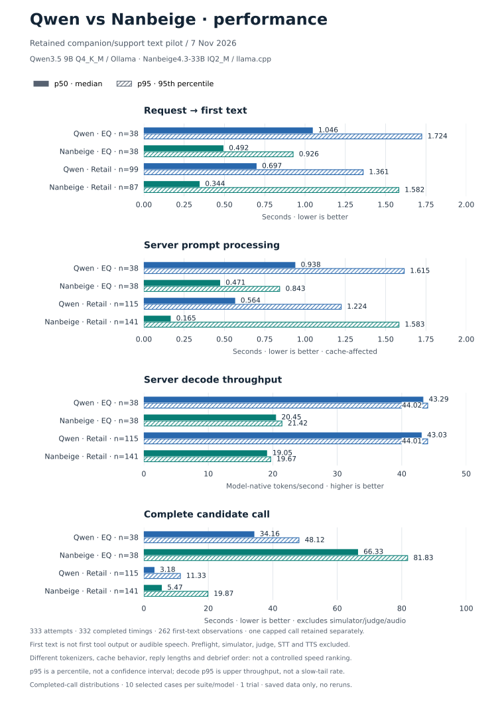

# Qwen-first companion/support pilot — 2026-11-07

## Recorded results


- [Final matched comparison: scores, failures, coverage and voice restoration](COMPARISON.md)
- [Saved performance evidence: first text, prompt processing, decode and wall-time distributions](PERFORMANCE.md)
- [Run audit: interpretation, fixed controls and known differences](RUN-AUDIT.md)
- [Matched Nanbeige IQ2_M run: progress, protocol and replay](results/nanbeige-iq2m/RESULTS.md)
- [Audited generation results and limitations](results/qwen-eq10/RESULTS.md)
- [Codex CLI rubric grading and individual assessments](results/qwen-eq10/codex-judge/RESULTS.md)
- [Retail task outcomes and current status](results/qwen-retail10/summary.json)
- [Progress / unfinished stages](results/qwen-eq10/progress.json)
- [Machine-readable summary](results/qwen-eq10/summary.json)
- [Scenario collection results](results/qwen-eq10/scenario-results.csv)
- [Per-call timing metrics](results/qwen-eq10/call-metrics.csv)
- [All transcripts and debriefs, gzip JSON](results/qwen-eq10/transcripts.json.gz)
- [Service recovery verification](results/qwen-eq10/post-run-verification.json)

Qwen response collection: **10/10 scenarios, 38/38 calls, no collection errors**.
Collection completion is **not an EQ quality score**. A subsequent independent
Codex CLI judge scored all ten scenarios: **4.30/20 mean qualitative rubric**.
This is a custom-judge subset score, not official leaderboard Elo or a pass
rate. The retail run uses the same independent CLI model as customer simulator
and semantic judge; its observed progress/outcomes are in the linked summary.
The matched Nanbeige run is complete: **5.57/20 EQ (10/10 graded), 8/10 retail**,
versus Qwen **4.30/20 EQ, 8/10 retail**. The original voice service was restored
and independently checked. Read the final comparison for failures, matching
controls and deliberate differences; no audio latency was measured.

### Retained performance



[Performance report and prompt/cache-counter chart](PERFORMANCE.md) ·
[Timing PNG](assets/qwen-nanbeige-performance.png) ·
[Exact chart data](assets/qwen-nanbeige-performance.json) ·
[Regeneration script](plot-performance.py).
Saved completed-call distributions, not a controlled speed ranking or an audio
test. Solid = p50; hatched = p95. Missing first-text and capped-call timings
are not replaced with zeros.

## Purpose and scope

Evaluate the actual local **Qwen3.5 9B Q4_K_M** and **Nanbeige IQ2_M** artifacts
for companion and customer-support behavior in a completed matched text pilot.
The earlier coding run was a poor match for this product.

This is a custom pilot, not an official EQ-Bench, τ-bench, or Artificial
Analysis leaderboard score. Text-model quality is separate from full-stack
voice latency and from TTS animal-sound control.

The final results/progress record is published alongside this file after
response collection. A pending judge or simulator must be reported as pending,
not converted into a quality score or a failed support task.

## Run ownership

OpenClaw hosts the chat/tools/session. The Codex agent in that session prepared
the fixtures and launched the local Python controller. The controller owns
sequential inference and service restoration. Qwen is the model under test,
not its own controller or semantic judge. Response collection used no separate
Codex worker. The follow-up judging/customer simulation uses fresh ephemeral
Codex CLI sessions; those do not control Qwen, access tools, or share dialogue
history across scenarios.

## Fixed selection

- EQ: ten preselected scenarios, 28 unchanged dialogue prompts and ten
  unchanged debriefs. IDs: `1, 2, 3, 6, 9, 13, 131, 133, 137, 302`.
- Retail: ten English `text-v1` tasks, the first ten IDs in the upstream
  frozen `retail_50` order: `6, 8, 11, 13, 14, 16, 17, 18, 19, 21`.
- One candidate attempt per case. No answer-based selection or silent retry
  of model failures. Subsets are not representative estimates of a full score.
- [EQ fixture/hashes](fixtures/eq10.json), [retail fixture/hashes](fixtures/retail10.json).

## Qwen collection profile

The speech application's normal 4K context/128-token answer limit cannot hold
these upstream introspective prompts and their multi-turn history. The pilot
uses the **same weights** with a separate benchmark configuration:

| Setting | Value |
| --- | --- |
| Context | 32,768; full-GPU placement checked before the run |
| Hidden thinking | Off, supported by this Qwen runtime |
| Sampling | Dialogue: temperature 0.7/min_p 0.1; debrief: temperature 0.5/min_p default 0; shared top_p 0.95/top_k 20 |
| Penalties | presence 0, repeat 1 |
| Seed / concurrency | 42 / 1 |
| Output cap | 12,000 tokens, as in upstream scenario/debrief calls |
| Call deadline | 600 seconds; 180-second idle-read timeout |
| Input protection | Exact GGUF vocabulary count plus conservative template margin; no truncation |
| Background residency | Parakeet STT and embeddings on GPU, Phonon TTS on CPU |
| Voice processing | Temporarily frozen; original 4K Qwen profile restored afterward |

The Ollama server version for the recorded run is 0.24.0 (the separate CLI
version is not used as server-version evidence). A fixed seed does not promise
bit-identical GPU execution.

The upstream debrief stage overrides temperature to 0.5 and supplies `min_p=None`;
the Qwen adapter sent JSON null, retaining Ollama's default zero (the alias has
no min_p override). This differs from the dialogue profile in the initial
manifest. The [actual per-stage sampling audit](results/qwen-eq10/sampling-audit.json)
and raw retained requests establish the executed settings. Nanbeige's debrief
adapter explicitly uses 0.5/0.0 to match them.

The controller records requests, raw NDJSON responses, usage/timing/resource
samples, per-scenario transcripts and recovery evidence. It refuses to
overwrite an existing run. Its upstream `ScenarioTask` implementation handles
the scenario structure and parsing; the adapter supplies local Ollama inference
and durable logging.

**Timing boundary:** the collected first-content-token time includes the
benchmark's visible introspective sections. It is not first useful spoken
reply, TTS/audio onset, or a browser/acoustic latency measurement. In the
original raw logs this field is named `first_answer_token_seconds`; interpret
it as first completion content, not voice responsiveness.

## Rerun the EQ collection

Prerequisites: Linux/NVIDIA, `uv`, Git, Ollama with the same Qwen artifact,
the exact GGUF file, `llama-tokenize` from the declared llama.cpp runtime, and
the named systemd user voice service. The script intentionally freezes that
service and restores it in `finally`; it is not a generic unattended command
for an arbitrary server. It refuses to start if the voice app reports a busy
call. Adapt the service and health URL before using it for another application.

```sh
bash setup.sh

# Point these at your local existing installation; do not download weights again.
export LLAMA_RUNTIME=/path/to/llama-b12064
export QWEN_GGUF=/path/to/the/existing/qwen-model.gguf
export EVAL_MODEL=local-voice-qwen:latest
export VOICE_SERVICE=local-voice-agent.service

.venv/bin/python -u run_qwen_eq.py > qwen-eq10.log 2>&1
```

Inspect `runs/qwen-eq10/progress.json`, `calls.jsonl`, `scenarios/`,
`placement.json`, `resources.csv` and `restore.json`. A completed response set
means generation succeeded; it does not mean the model passed the EQ scenario.
Independent rubric judging or blinded human comparison is a separate stage.
After completion and service recovery, run `.venv/bin/python audit_qwen_eq.py`
to produce `summary.json`, `scenario-results.csv`, `call-metrics.csv`,
`transcripts.json` and `RESULTS.md`.

The published runner only replaces original machine-specific path literals
with environment variables. Its generation settings and scenario logic are
unchanged. Full upstream code is fetched at pinned revisions, not vendored here.

## Codex CLI judge and retail simulator

The user selected `gpt-6.1-sol` with `xhigh` reasoning through the existing
Codex CLI ChatGPT login. The ordinary CLI profile was authenticated even though
OpenClaw's inherited separate `CODEX_HOME` was not. Check the intended profile
with `CODEX_HOME="$HOME/.codex" codex login status`; do not conclude that no
hosted evaluator is available from a missing API key alone.

`codex_cli_judge.py` selects the model/effort explicitly, ignores user config
and rules, disables shell/multi-agent/apps/skill search/web, suppresses project
instructions, and requests schema-constrained final output in a read-only
fresh ephemeral session. It uses the existing login without reading/copying
credentials. This consumes Codex usage; no dollar charge is inferred from
subscription inference and no API-key fallback is attempted.

`grade_qwen_eq.py` uses upstream full-transcript rubric preparation, with brief
evidence assessments replacing the detailed-reasoning output field. It
validates all 18 numerical rubric fields; only the six higher-is-better fields
are averaged for the quality mean. Original collected states stay unchanged.
See the [judge report](results/qwen-eq10/codex-judge/RESULTS.md) for exact replay
commands and limitations.

`run_qwen_retail.py` intercepts the upstream provider seam, not the policy,
environment tools, state replay, task evaluation or customer instructions.
Qwen uses native local Ollama tool calls; Codex CLI supplies the separate
customer and semantic judgments. A task cannot pass just because the model
claims success. An unexpected provider or customer tool schema aborts instead
of silently making a paid API call or faking a tool.

Retail profile: frozen English task IDs, one attempt, 32K context, thinking
off, temperature 0.5/min_p 0.1/top_p 0.95/top_k 20, presence 0/repeat 1,
seed 42, output cap 1,024; task seed 300, max 200 steps/10 tool errors,
1,800-second task budget. A conservative full-request GGUF-vocabulary count
plus a template margin prevents silent history truncation. Raw request/stream
evidence remains local. The first scored task was retained during resume;
its monitoring and restoration files are archived, not discarded.

```sh
# Requires the same local runtime/weights/service environment as EQ collection.
CODEX_JUDGE_HOME="$HOME/.codex" .venv/bin/python run_qwen_retail.py --preflight
CODEX_JUDGE_HOME="$HOME/.codex" .venv/bin/python -u run_qwen_retail.py
# If extending the preserved one-task pilot, use --resume instead.
```

The retail runner temporarily freezes voice processing, preserves STT and
embedding residency, and restores the ordinary 4K Qwen profile in `finally`.
Do not interrupt its recovery; inspect `restore.json` and independently check
service readiness after completion. Completed task outcomes, not just an
earlier integration-pilot restore, determine current run status.

## General evaluator dependency checks

Retail needs an independent customer simulator. τ-bench 2.0 defaults also
require semantic communication/NL-assertion judges. Those must be fixed for
both candidate models. There is no implicit authorization to spend on hosted
APIs, and switching to a weaker CPU simulator changes the experimental setup.

Do not run the upstream CLI blindly with its paid default simulator/judges.
Its resolved dry-run plan and fixture selection can be prepared without making
model calls. A simulation is not executed until the provider/cost or offline
route is explicit. The same applies to assigning an EQ rubric score.

## Provenance

- EQ-Bench 3: `affc5a000bbdb965b807e09ca7875f8530fa8f56`.
- τ-bench: `033bf082f48e4a3c6a1256208e93cf2ce9c3bb6f` (2.0.0 source).
- Python 3.12; package versions in [requirements.lock](requirements.lock).
- `setup.sh` adjusts the pinned τ-bench LiteLLM requirement to allow the
  security-patched 1.84.0 release and checks installed dependency compatibility.
- `llama-tokenize`: llama.cpp b12064 / `51fe42c5d`.
- Fixture/software notices: [EQ-Bench license](licenses/eqbench3/LICENSE),
  [Sierra license](licenses/tau2-bench/LICENSE).
- Model hash, measured GPU/RAM usage, completion/failure counts and service
  recovery belong in the specific results report, not assumptions in this setup.
