# Drama 3 architecture and training data flow

2026-11-07 · [Revision and source ledger](SOURCES.md)

**Evidence labels.** Released code and metadata describe the runnable inference model. The technical report describes Fish Audio's training. The proposed smoke test reconstructs only the single-turn cloning objective. Aratako has not published the corresponding training forward or data builder in the sources checked.

```mermaid
flowchart LR
    A["Reference and target waveforms"] --> B["Frozen causal DAC + RVQ"]
    B --> C["10 ordered codes per frame"]
    T["Transcript, controls, reference transcript"] --> D["Tokenizer + indexed ChatML"]
    C --> D
    D --> E["Input token + code 1 fusion"]
    E --> F["40-layer hybrid MoE backbone"]
    F --> G["LM head: next semantic code or EOS"]
    F --> H["Codebook decoder: 4 shared + 9 per-codebook layers"]
    C -->|"Input frame codes 2–9"| H
    G -->|"Next code 0: label in training, sample in generation"| H
    H --> I["Nine causal residual-code heads"]
    G --> J["Semantic + residual frame"]
    I --> J
    J -->|"Generated audio only"| K["Frozen DAC waveform decoder"]
```

## Component map

Paths below refer to Fish Speech at `0f8a12e8a651062fdee9c33a894bdccd3a8513f1`. The published Japanese checkpoint has the same config values and tensor namespace as the two upstream revisions inspected. See [SOURCES.md](SOURCES.md) for weight provenance.

| Component                 | What the release contains                                                                                                                                                                                                                                                                                                                                                                                                                                                                                                                                                                                                                                              | Source                                                                                                                                                                                                                                                                                                                                                                                                                                                             |
| ------------------------- | ---------------------------------------------------------------------------------------------------------------------------------------------------------------------------------------------------------------------------------------------------------------------------------------------------------------------------------------------------------------------------------------------------------------------------------------------------------------------------------------------------------------------------------------------------------------------------------------------------------------------------------------------------------------------- | ------------------------------------------------------------------------------------------------------------------------------------------------------------------------------------------------------------------------------------------------------------------------------------------------------------------------------------------------------------------------------------------------------------------------------------------------------------------ |
| Text tokenizer and prompt | Qwen-derived BPE loaded from `tokenizer.json` using `tokenizers.Tokenizer`. LM vocab capacity 252,288. IDs from the pinned artifacts: pad / end-of-text 248044, ChatML start 248045, ChatML end / speech EOS 248046, audio placeholder 248076, voice 248081, speaker 0–15 at 248083–248098, semantic codes 0–4095 at 248099–252194. `[Reference N]`, `Text:`, `Speech:`, natural-language directions and tags are ordinary text.                                                                                                                                                                                                                                       | [Tokenizer](https://huggingface.co/fishaudio/drama-3/blob/78e5ab79e49aa9a25abe8799eff2c4d73a1c3216/tokenizer.json), [config](https://huggingface.co/fishaudio/drama-3/blob/78e5ab79e49aa9a25abe8799eff2c4d73a1c3216/config.json), [prompt builder](https://github.com/fishaudio/fish-speech/blob/0f8a12e8a651062fdee9c33a894bdccd3a8513f1/fish_speech/models/text2semantic/fish_omni/generate.py#L96), [report Appendix C](https://arxiv.org/html/2610.18010v2#A3) |
| Backbone                  | Qwen3.5-35B-A3B language initialization, width 2048, 40 blocks (30 Gated DeltaNet and 10 full attention in groups of three then one). Full attention uses 16 query heads, 2 KV heads, 256 head dim, gated output, Q/K norm and partial RoPE. DeltaNet uses causal depthwise convolution and a recurrent delta rule. Untied token table and LM head, each `[252288, 2048]`.                                                                                                                                                                                                                                                                                             | [Backbone and loader](https://github.com/fishaudio/fish-speech/blob/0f8a12e8a651062fdee9c33a894bdccd3a8513f1/fish_speech/models/text2semantic/fish_omni/backbone.py), [attention and DeltaNet](https://github.com/fishaudio/fish-speech/blob/0f8a12e8a651062fdee9c33a894bdccd3a8513f1/fish_speech/models/text2semantic/fish_omni/layers.py)                                                                                                                        |
| Routed and shared experts | Each backbone layer has 256 routed SwiGLU experts (intermediate width 512), top 8 with normalized softmax weights, and one sigmoid-gated shared dense expert. Disk tensors are per expert, with FP8 `gate_proj`, `up_proj` and `down_proj`, each with FP32 128×128 block scales. Runtime stacks gate/up into `w13_weight [256,1024,2048]` and down into `w2_weight [256,2048,512]`. FP8 uses buffers, BF16 uses 3-D parameters. Router and shared projections are ordinary linears.                                                                                                                                                                                    | [Expert implementations](https://github.com/fishaudio/fish-speech/blob/0f8a12e8a651062fdee9c33a894bdccd3a8513f1/fish_speech/models/text2semantic/fish_omni/moe.py), [FP8 dispatch](https://github.com/fishaudio/fish-speech/blob/0f8a12e8a651062fdee9c33a894bdccd3a8513f1/fish_speech/models/text2semantic/fish_omni/fp8_moe.py)                                                                                                                                   |
| Reference conditioning    | `audio_encoder_config` is null. The waveform codec encodes references into discrete frames, paired with their transcripts in indexed system-turn blocks. For each audio input row the backbone sees `(E_lm[semantic_id] + E_code1[c1]) / sqrt(2)`. Ordinary text uses only `E_lm`. A packed `[40960,2048]` codebook embedding table resides under `audio_decoder.codebook_embeddings`. The tower receives input-frame codes 2–9 via the first shared layer. There is no separate reference speaker embedding network in the shipped TTS model.                                                                                                                         | [Prompt layout and reference packing](https://github.com/fishaudio/fish-speech/blob/0f8a12e8a651062fdee9c33a894bdccd3a8513f1/fish_speech/models/text2semantic/fish_omni/generate.py#L141), [fusion and shared layers](https://github.com/fishaudio/fish-speech/blob/0f8a12e8a651062fdee9c33a894bdccd3a8513f1/fish_speech/models/text2semantic/fish_omni/tower.py#L370)                                                                                             |
| Codebook decoder          | Width 2048. Four shared enrichment layers inject the next frame's semantic code. Nine successive residual layers each inject the preceding code of that same next frame, then predict the next codebook with its own `[4096,2048]` head. Each stage merges normalized hidden state and code embeddings, then applies gated causal attention over time and a dense SwiGLU. This is a 13-layer decoder despite config `n_layer: 4`. `max_seq_len: 11` is not the runtime tower's attention capacity. The code allocates time caches for the input plus requested output. Tower Q/K norms are always used despite the exported false flag, per the implementer's comment. | [Decoder layers and parameters](https://github.com/fishaudio/fish-speech/blob/0f8a12e8a651062fdee9c33a894bdccd3a8513f1/fish_speech/models/text2semantic/fish_omni/tower.py#L146), [report §2.4](https://arxiv.org/html/2610.18010v2#S2.SS4)                                                                                                                                                                                                                        |
| Waveform codec            | Separate causal Descript Audio Codec derivative. Mono at 44,100 Hz, encoder hop `2×4×8×8 = 512` samples, quantizer downsamples another factor of four. One frame every 2,048 samples, about 21.53 frames/s. Code 0 is semantic (4096 entries), codes 1–9 are residual (1024 entries each). `encode` right-zero-pads to the frame length and returns codes `[B,10,F]` and `ceil(n_samples/2048)` valid lengths. `from_indices` expects `[B,10,F]` and returns waveform `[B,1,samples]`. Decoder clamps out-of-range residual IDs, so round-trip audio alone does not validate indices.                                                                                  | [Codec config](https://github.com/fishaudio/fish-speech/blob/0f8a12e8a651062fdee9c33a894bdccd3a8513f1/fish_speech/configs/modded_dac_vq.yaml), [codec interface](https://github.com/fishaudio/fish-speech/blob/0f8a12e8a651062fdee9c33a894bdccd3a8513f1/fish_speech/models/dac/modded_dac.py#L861), [quantizer order and decode](https://github.com/fishaudio/fish-speech/blob/0f8a12e8a651062fdee9c33a894bdccd3a8513f1/fish_speech/models/dac/rvq.py#L316)        |

## One training example

Fish Audio describes three pretraining stages, instruction SFT and preference RL. The earlier stages use concatenated references. Stage 3 also uses indexed references, which are the standard format from SFT onward. The proposed probe uses the indexed single-turn form. Fish Audio's RL freezes the tower and scores semantic tokens and EOS. The probe trains on recorded audio codes with CE, so it needs the tower's input gradients. [Fish Audio report §3](https://arxiv.org/html/2610.18010v2#S3)

1. **Prepare separate audio clips.** Start with a consented speaker's target WAV and verbatim transcript, a manually placed event tag if the event is audible, and one disjoint reference WAV and transcript. Downmix and resample both to 44.1 kHz, encode each with the same pinned codec and preserve the valid length. Cache integer `[10,F]` arrays offline. Keep event labels and timing in the manifest. A reference is conditioning, so it must not contain the target utterance or overlapping samples.
2. **Construct the sequence.** Use `build_drama3_prompt` with indexed references and the tagged target text. It tokenizes each literal separately, including the start of the assistant voice turn. Text rows are `[id,0,…,0]` with zero-filled code columns. Audio rows are `[248099+c0,c0,c1,…,c9]`. Append the target audio rows and one `[EOS,0,…,0]` row. The released builder ends at the open assistant voice turn. Appending the target and one EOS is the proposed single-turn training convention, supported by the paper's conversation and loss descriptions.
3. **Shift once.** With `rows [T+1,11]`, set `x=rows[:-1]` and `y=rows[1:]`. The final prompt row predicts the first target semantic frame. The last target frame predicts EOS. Build masks from the label row's role and type, never from the input row. Use one unpadded example per microbatch. There is no general padding or document-mask interface on the inspected backbone forward. Fish Audio packs sequences with document masks during pretraining. Any future padded/batched variant needs an explicit valid-row mask, attention isolation, and per-document Gated DeltaNet state resets. Codec sample padding is a separate concern.
4. **Compute teacher-forced logits.** Fuse the current input row, pass `[1,T,2048]` through a cache-free backbone, and project hidden states with the LM head. At row `t`, the tower receives only the backbone state through `t`, input-frame detail through `t`, and lower-order true codes of the frame at `t+1`. Use `run_shared` and each residual layer/head explicitly. `prefill` demonstrates the shift but discards head logits and returns no training loss. Run the causal tower on **all** prompt and target positions, including the known reference labels. Gathering only supervised rows before the attention layers would remove conditioning. Gather only before logits/CE. Full shapes are `[T,252288]` for the LM head and `[T,4096]` per residual head (single example). Disable caches and CUDA graphs. Keep the Gated DeltaNet recurrence causal and use causal SDPA in full-attention blocks. The tower's `semantic` mask selects rows where the **next** token is semantic, so the injected next-code embedding is zero for text/EOS. The first shared layer can still see current audio detail there.
5. **Score the assistant labels.** The paper's pretraining objective is `L_text + 0.5 L_sem + 0.5 L_cb`. Each term averages over its own supervised positions. `L_cb` averages the nine next-code cross-entropies. `L_text` includes assistant EOS and applicable line separators. The smoke test has only one EOS and no separators. Mask all system, user and reference label rows. Reference rows can still influence gradients through later causal states. Apply full-vocab LM and full-4096 residual-head CE as an explicit prototype choice until the private training head masking is established. Keep the training codec frozen and outside the graph. There is no waveform reconstruction, commitment, or VQ loss in this experiment. [Fish Audio report §§2.4, 3.1–3.3](https://arxiv.org/html/2610.18010v2#S3)
6. **Update and export.** In the proposed run, gradients update only LoRA factors on the last four attention output projections. Earlier hidden states and all base weights are frozen. The tower is frozen but must propagate gradients to the adapted backbone when acoustic CE is included. Export named adapter factors, rank/alpha, exact base/code revisions, dtype and target map. If expanding to train embeddings/decoder, save those tensors too, with namespace and reload tests. The Japanese full checkpoint exposes trained weights for inference but cannot identify its optimizer or merge procedure from layout alone.

**Why the shift matters.** Passing the next true semantic ID to the backbone would leak its own target. Passing true next code 0 into the shared tower or true next code `k-1` into head `k` is legitimate codebook teacher forcing. Give the prompt only reference audio in free-running evaluation. During generation the backbone samples over EOS plus 4096 semantic IDs, the tower fills the nine residual codes in order, and the sampled frame feeds back at the next position. `generate_drama3` stops on EOS or the frame cap and drops EOS from returned codes. In the pinned runtime, `--reference-sampling` constrains residual draws to codec-valid codes and changes sampling rules. The default sampler draws from the full residual head. Use one fixed path for both baseline and adapter. [Generation loop](https://github.com/fishaudio/fish-speech/blob/0f8a12e8a651062fdee9c33a894bdccd3a8513f1/fish_speech/models/text2semantic/fish_omni/generate.py#L196), [sampling implementation](https://github.com/fishaudio/fish-speech/blob/0f8a12e8a651062fdee9c33a894bdccd3a8513f1/fish_speech/models/text2semantic/fish_omni/tower.py#L416)

## Unresolved details and checks

| Unknown                                            | Evidence or experiment needed                                                                                                                                                                                                                                                                                                                                                                |
| -------------------------------------------------- | -------------------------------------------------------------------------------------------------------------------------------------------------------------------------------------------------------------------------------------------------------------------------------------------------------------------------------------------------------------------------------------------- |
| Exact Fish/Aratako training layout and masking     | Obtain the training collator and a redacted serialized single-example tensor dump, including shifted rows, valid lengths, document IDs and loss masks. Compare them against the native `build_drama3_prompt` seams and the proposed single-EOS convention.                                                                                                                                   |
| Exact SFT/Japanese loss, weights, and logits masks | Obtain the training forward, loss/optimizer config and residual-logit masking. Exported `codebook_loss_weight_per_layer: null` and 4096-wide heads do not settle the normalization domain or per-stage weighting. Check CE against hand-computed toy logits and whether the Japanese run uses extra regularizers.                                                                            |
| No-cache equivalence and backward                  | Capture per-position logits from the cache-free candidate and an instrumented cached teacher-forced pass using the same true codes. Compare all heads, the initial target and EOS boundaries, and a suffix perturbation that must leave earlier logits invariant. Run a gradient check through `F.linear` grouped experts, Gated DeltaNet, SDPA and all tower layers on the intended device. |
| Exact Japanese base snapshot and target modules    | Obtain the source checkpoint SHA, adapter target/parameter manifest, training precision and export script. Shapes and byte-range fingerprints can establish compatibility and lineage evidence, but not which original revision was loaded at training time.                                                                                                                                 |
| Speaker/tag conditioning recipe                    | Obtain one redacted source → clip → transcript → annotation → packed-example record, reference selection rules, and source/speaker split provenance. The Japanese inference demo can confirm a prompt spelling only.                                                                                                                                                                         |
