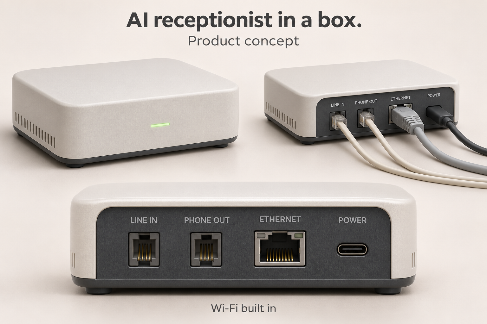
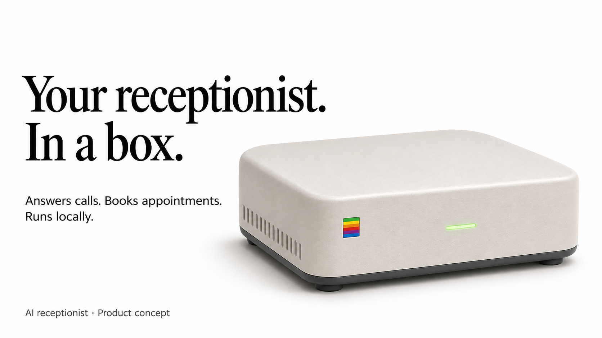
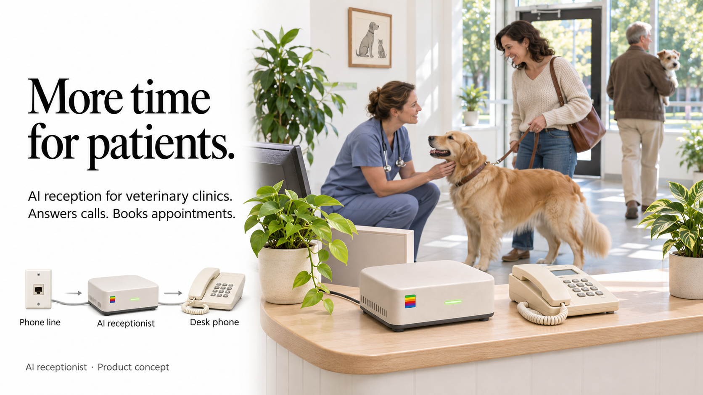

# Fax in the era of AI

An agent-to-agent phone protocol

## AI receptionist in a box



A hardware concept for restaurants, hotels, and veterinary clinics. It sits
between the phone line and desk phone, with two RJ11 ports, Ethernet,
USB-C power, and built-in Wi-Fi.

The goal is to run speech recognition, the language model, and speech generation
on the device, answering calls and checking availability through connected
booking software without an AI subscription.

Cloud booking integrations and remote HTTP/MCP handshakes still need a network
connection. Phone service and third-party software may have their own costs.

Concept render generated with imagegen. [Generation prompt](references/ai-receptionist-prompt.txt).

### Product slide



[Product slide prompt](references/ai-receptionist-1996-slide-prompt.txt).

### Veterinary clinic



[Veterinary clinic slide prompt](references/ai-receptionist-vet-slide-prompt.txt).

## Demo booking number

Practical MVP path with Telnyx and LiveKit.

### What you actually build

A single Telnyx number that:

- Answers humans with a normal voice agent (“Hi, book a demo with the founders…”).
- Detects when the caller is another agent, does a short DTMF handshake, then finishes the booking over HTTP/MCP against your calendars.
- Returns a signed confirmation so the calling agent can prove the booking happened.

This is the hybrid pattern that already exists in the wild (especially **Agent Handshake / Counter Protocol**).

### Closest existing pieces

| Piece | What it gives you | Link |
| ----- | ----------------- | ---- |
| **Agent Handshake** (Counter Protocol) | Exact DTMF frames (OFFER / PROBE / BIND), registry, signed receipt, MCP tools | [github.com/viva-lee/agent-handshake](https://github.com/viva-lee/agent-handshake) |
| **GibberLink** | Data-over-sound fallback (ggwave) if you want pure audio | [github.com/PennyroyalTea/gibberlink](https://github.com/PennyroyalTea/gibberlink) |
| **LiveKit DTMF** | Send + receive DTMF natively in the agent | [docs.livekit.io/telephony/features/dtmf](https://docs.livekit.io/telephony/features/dtmf/) |
| **Telnyx** | Number + DTMF events + LiveKit plugin | [Telnyx LiveKit docs](https://developers.telnyx.com/docs/inference/livekit) |

### Realistic MVP architecture (with your stack)

```text
Caller (human or personal agent)
        │
        ▼
Telnyx number → SIP → LiveKit room
        │
        ▼
LiveKit Agent (your Brisa-style receptionist)
  • Normal speech for humans
  • Listens for DTMF + agent speech cues
        │
        ├─ Human path → keep talking, book via tools
        │
        └─ Agent path →
             1. Send OFFER DTMF (*#1…#)
             2. Caller resolves + calls your HTTPS endpoint
             3. Caller sends BIND DTMF
             4. Booking happens over MCP / HTTP
             5. You return signed receipt
```

### Phased build (smallest first)

**Phase 1 – Voice receptionist (1–2 days)**  

- Buy a Telnyx number.  
- Point it at a LiveKit agent (you already do this for Brisa).  
- Agent books demo slots by talking (Cal.com, Google Calendar, or simple internal calendar).  
- Works for humans and for agents that still speak English.

**Phase 2 – DTMF handshake detection (2–3 days)**  

- In the LiveKit agent, listen for DTMF (LiveKit has this).  
- On detecting a PROBE or after “I’m an AI agent” speech, reply with an OFFER frame.  
- Hard-code a simple rendezvous code that points at your own endpoint for the demo.  
- Reference the exact frame format from Agent Handshake (`*#1` + registry + code + Luhn + `#`).

**Phase 3 – Off-channel booking (2–4 days)**  

- Small HTTP or MCP server that the calling agent hits after the handshake.  
- Endpoints: `check_availability`, `hold`, `book`.  
- Back it with your real calendars (or a simple JSON calendar for the demo).  
- Return a signed receipt (Ed25519 is what Agent Handshake uses).  
- BIND DTMF ties the API session back to the specific call.

**Phase 4 – Spam / trust (add as needed)**  

- Single-use sessions + short expiry on the rendezvous code.  
- Require a signed mandate from the calling agent.  
- Rate-limit per caller number / agent key.  
- Optional: only accept agents that present a known public key or come from a small allow-list for the demo.

### How a personal agent would use it (demo script)

1. User tells ChatGPT / Claude / Grokbot: “Book a demo with [your number] for next week.”  
2. The agent calls the number (via your Agent Caller product, Telnyx, or whatever telephony it has).  
3. Both sides exchange the short DTMF handshake.  
4. The personal agent then hits your MCP/HTTP endpoint with the bind code and the user’s preferred times.  
5. Your server checks founder availability, books the slot, returns a signed receipt.  
6. The personal agent reads the receipt back to the user and hangs up.

### Spam protection reality check

Once agents can call agents, spam is real. The Counter Protocol approach already addresses the main vectors:

- Channel binding (BIND frame proves the API caller is the same party on the phone).  
- Signed mandates + single-use sessions.  
- Short-lived rendezvous codes.  
- Business-signed receipts so the calling agent can prove what was booked.

You can start with a simple allow-list of known agent keys for the demo, then tighten later.

### Recommended starting point

Clone **viva-lee/agent-handshake**, run their playground, then port the DTMF frame logic and the MCP booking tools into your existing LiveKit agent + a small FastAPI/MCP server. You already have the telephony and voice pieces; the missing piece is the handshake → structured booking switch.
